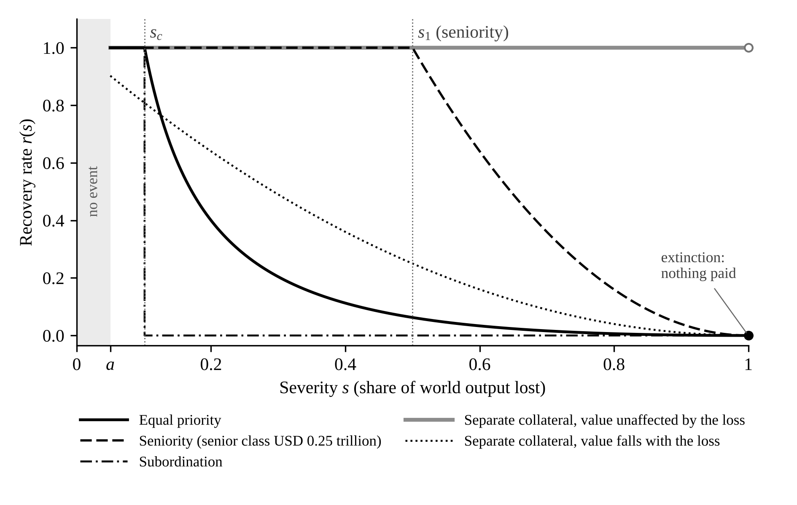

# Capital Destruction and the Limits of Insurability

Code for the numerical examples, tables and figures of

> Aslan, I. (2026). Capital destruction and the limits of insurability: What prices reveal about catastrophic risk from artificial intelligence. Working paper. [SSRN 7198561](https://ssrn.com/abstract=7198561)



Prices of insurance and event contracts are often read as probability forecasts, and could be read that way for catastrophes caused by artificial intelligence. A claim payable only at extinction is worthless at any probability. A small claim on a survivable loss is paid in full if the assets behind it survive and are not over-committed, so its price reveals the probability. The paper studies the case in between: the loss destroys part of those assets and triggers competing claims. Under pro rata sharing, even the smallest claim then stops being paid in full, and if the severity of the event is unknown its price reveals only a range of probabilities.

## Stylised economy

All amounts in USD trillion: world output 100; assets of the insurance pool 1; the event is a loss of at least 5 per cent of world output; assets surviving a loss of share `s` are `(1 − s)²`; other claims on the pool are `8s`, or 8 per cent of the aggregate loss. Prices are expected payments per dollar promised, in cents.

## Main results

Five economies in which the same claim costs 1 cent (Table 4):

| Severity if the event occurs | Paid (cents per dollar) | Event probability | Expected loss from the event |
|---|---|---|---|
| 10% | 100 | 1.0% | 0.10 |
| 20% | 40.0 | 2.5% | 0.50 |
| 30% | 20.4 | 4.9% | 1.47 |
| 40% | 11.3 | 8.9% | 3.56 |
| 60% | 3.3 | 30.0% | 18.00 |

An observer who sees only the price cannot tell these economies apart. If severity is known not to exceed 40 per cent, the price places the probability between 1 and 8.9 per cent; the ratio 8.9 is over-commitment (3.2) times capital destruction (2.78). Claims at five thresholds between 5 and 80 per cent of world output narrow the interval to 1.8 to 2.7 per cent, and ten such claims to 1.9 to 2.2 per cent (Appendix B.2).

## Files

| File | Content |
|---|---|
| `replicate.py` | Every number in Sections 2, 3.3, 4.3, 4.5, 4.6 and 5, in the notes to the tables and figures and in the online appendix |
| `results/output.txt` | Console output: Tables 3 to 5, Table B1, the ladder economy and the appendix calculations |
| `results/fig1_recovery.png` | Figure 1: recovery rate on a small claim, by severity and allocation rule |
| `results/fig2_identification.png` | Figure 2: (a) upper bounds on the event probability implied by a price of 1 cent; (b) a ladder of claims |

## Running the code

```
python -m pip install -r requirements.txt
python replicate.py
```

The script runs in about two seconds; it takes an optional output folder as its argument (default `results`). The calculations are deterministic. It was last checked with Python 3.13, NumPy 2.5, SciPy 1.18 and Matplotlib 3.11.

## Citation

Please cite the paper. GitHub's "Cite this repository" button gives the reference in APA and BibTeX formats.

## Licence

MIT licence (see `LICENSE`).

## Author

Ilker Aslan, Lecturer, Kalaidos University of Applied Sciences, Zürich
[ORCID 0000-0001-9241-9420](https://orcid.org/0000-0001-9241-9420) · [ilkeraslan.github.io](https://ilkeraslan.github.io)
